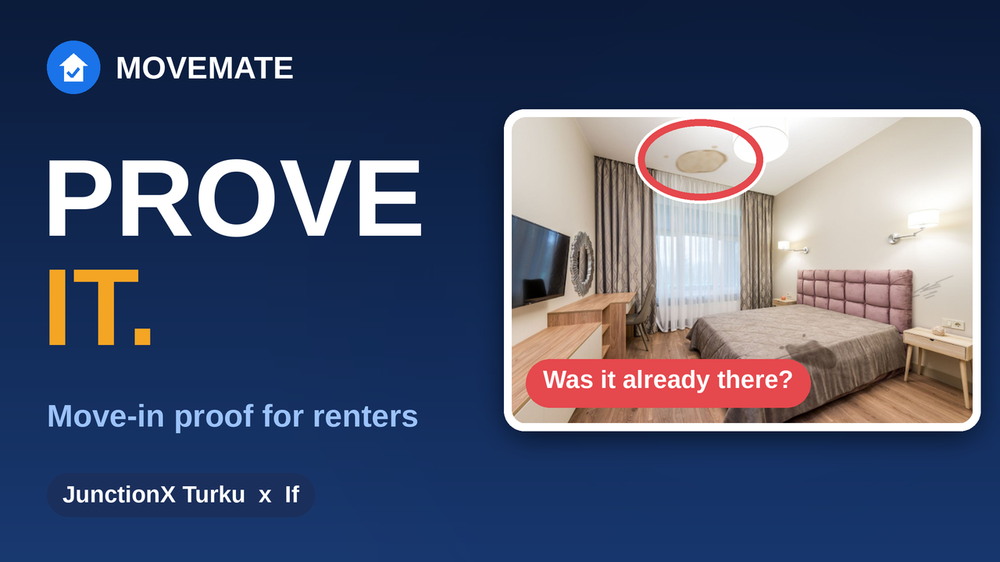
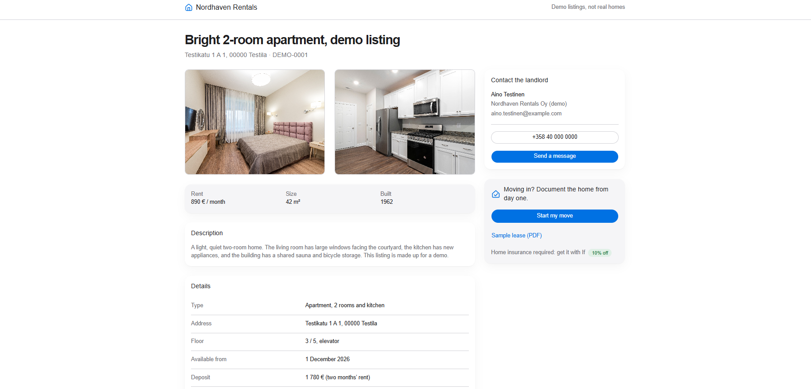
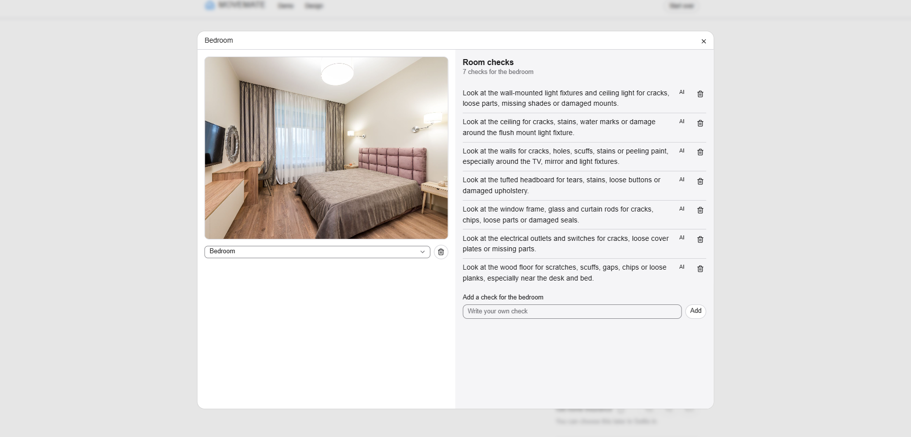
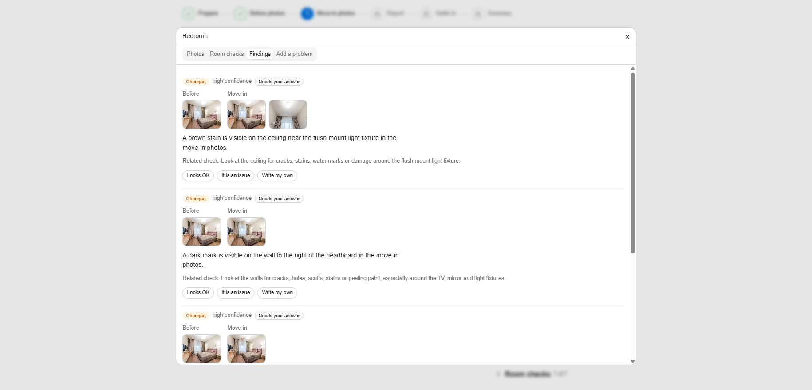
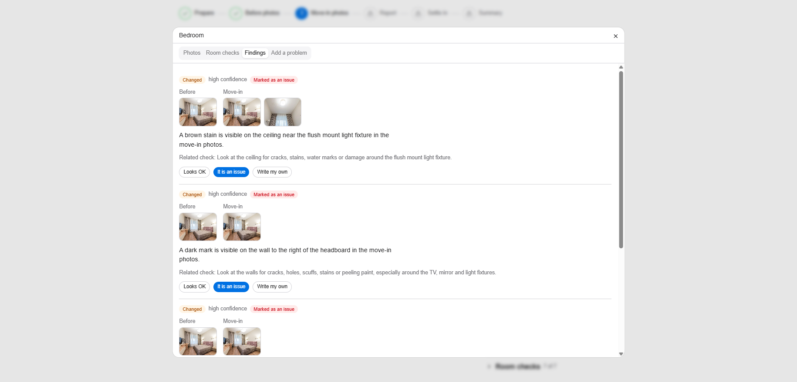
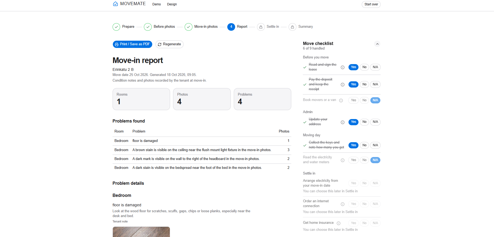
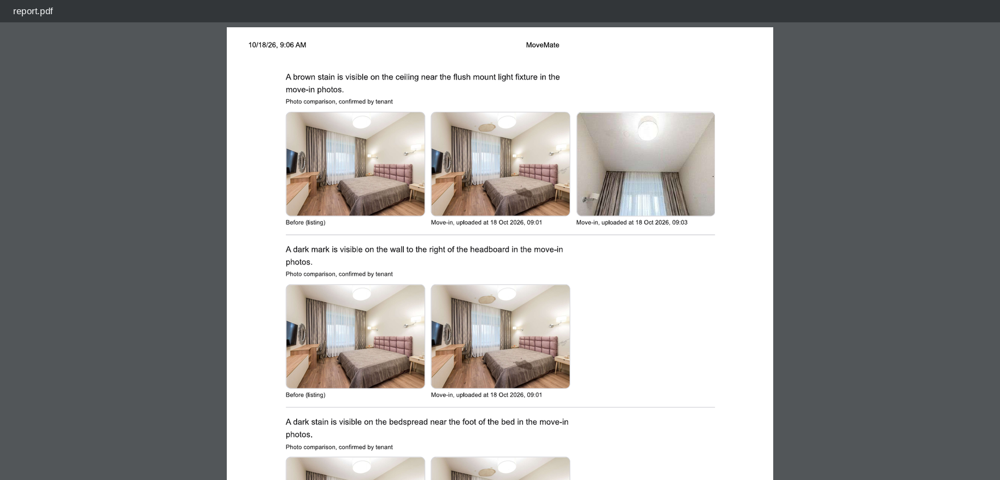
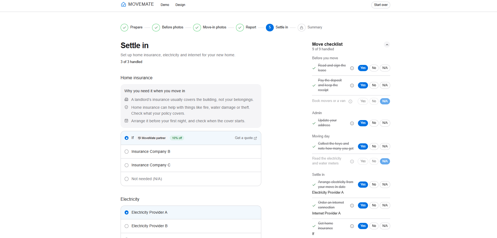
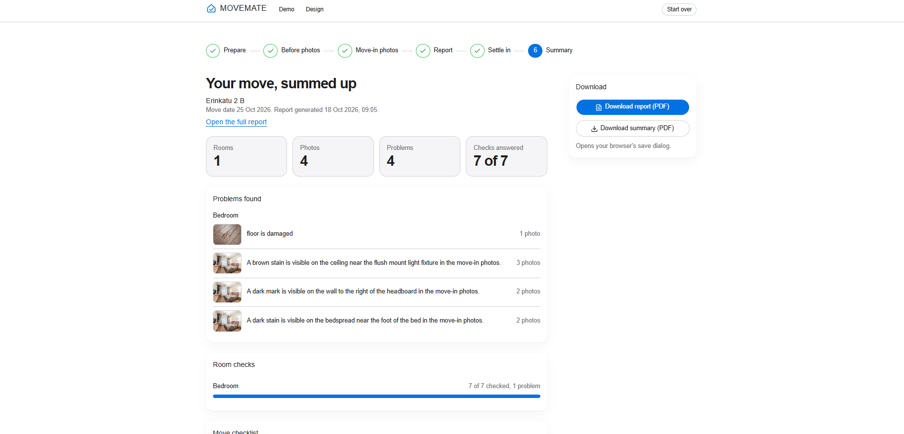

# MoveMate

MoveMate helps renters prove what condition a home was in when they moved in. You photograph each room, an AI model compares those photos with the listing photos, you confirm every result, and MoveMate produces a dated report you can hand to your landlord.

<a href="https://www.youtube.com/watch?v=gIWQTVlLvH4"></a>

<!-- TODO: add walkthrough video link -->

---

## What MoveMate is

**The problem.** Renters often cannot show what an apartment looked like on day one. When they move out, they risk being blamed, and losing part of the deposit, for damage that was already there.

**The idea.** A guided move in five phases, then a Summary:

1. **Prepare**: a Move checklist and planning tips.
2. **Before photos**: upload listing or viewing photos by room. AI suggests what to check on move-in day.
3. **Move-in photos**: upload your own photos, answer each room check, add problems, and compare against the before photos.
4. **Report**: a landlord-facing, dated record of the move, frozen when generated.
5. **Settle in**: pick electricity, internet and home insurance providers. If is highlighted.
6. **Summary**: the whole workflow in one place, with PDF downloads.

**Who it is for.** Tenants moving into a rented home, mostly in Finland. It is built for the If insurance challenge at JunctionX Turku.

This is a hackathon project. It runs on localhost, for one user, with no login and no deployment.

---

## Screenshots



_The demo listing. Its photos are the "before" state._



_AI room checks, suggested from the before photos._



_AI findings from comparing before and move-in photos._



_The renter confirms each finding. Nothing enters the report before that._



_The report: problems found, per room._



_Before and move-in photos side by side._



_Settle in. The 10% discount and the code MOVEMATE10 are demo content, the offer we propose to If, not a live deal._



_The summary: problems, room checks, checklist and the 30-day watch list._

---

## How it works

### Phase by phase

**Prepare.** A common move-in checklist. Each item is answered Yes, No or N/A, and answers are saved. Pressing the active answer again sets it back to pending. Planning tips sit next to it. Nothing here blocks you.

**Before photos.** Upload listing or viewing photos and label each by room (up to 4 per room). The AI looks at each room and suggests checks for move-in day, such as "check whether the window sill has a mark". You can add your own checks. Running the analysis again replaces only AI checks you have not answered yet.

**Move-in photos.** Upload photos again, by room (up to 8 per room). Then:

- Answer each room check: **Looks fine**, **Problem** (a note of up to 500 characters and up to 3 photos) or **N/A**.
- Add your own problem in any room, with or without photos.
- Run the **photo comparison**. The AI compares before and move-in photos per room and returns findings marked looks good, changed or unclear. You confirm each one as OK, an issue, or write your own answer.

**Report.** The main output. A landlord-facing page with a cover block, stat cards, a "Problems found" table, one section per room with problems, a 30-day watch list, and appendices with every photo and every room check answer. It is frozen at the moment you generate it, so later edits do not change it. Print it or save it as PDF from the browser (A4 layout). Generating is blocked only by findings you have not answered yet, or a move with no move-in photos.

**Settle in.** Pick a provider for electricity, internet and home insurance, or mark a category as not needed. If is highlighted with a discount badge and an optional "Get a quote" link. No prices are shown. Your choices update the matching Move checklist items.

**Summary.** The record of the whole workflow: problems, room checks, checklist, the 30-day watch list date. Buttons open the browser print dialog for the report or for the summary.

### The Move checklist

A side panel in every phase (a drawer on small screens). The electricity, internet and home insurance items are linked to Settle in. They are locked until you reach that phase, and then follow your provider choices.

### Three sources, one list of problems

Problems reach the report from three places and appear as one list per room, each with a small source label:

| Source                                  | Label in the report                   |
| --------------------------------------- | ------------------------------------- |
| A room check you answered **Problem**   | Tenant note                           |
| A problem you added yourself            | Tenant note                           |
| An AI finding you confirmed as an issue | Photo comparison, confirmed by tenant |

Findings you mark OK, and "looks good" results, are not problems.

---

## AI

- **Provider.** [OpenRouter](https://openrouter.ai) chat completions. One vision-capable model, set by `OPENROUTER_VISION_MODEL`. Output is always validated against a schema. One retry on invalid JSON, then the app shows an error and you continue by hand.
- **Two jobs.** Suggest checks from before photos, and compare before and move-in photos per room.
- **Free model limits.** The Docker default is `nvidia/nemotron-3.5-super-vl:free`. Free models are rate limited, can be slow and can be removed by the provider without notice. If calls fail, wait a minute, or set another vision model that supports image input and JSON output.
- **What the AI will never claim.** It describes only what is visible and uses cautious wording ("a mark may be visible"). It never says a room is safe, clean or free of damage, and never infers fault, liability or insurance coverage. When angles or lighting differ, it prefers "unclear" over guessing.
- **Manual fallback.** With no API key, or when OpenRouter fails, every screen still works. You add checks and answer findings by hand. AI screens show "AI is not set up".
- **Privacy.** Photos are sent to OpenRouter only when you run an analysis or comparison. The app logs the model id and duration, never image data or keys.

**Important.** The report is tenant-recorded evidence. It is not a legal, deposit or insurance determination. The If discount (10 percent for 12 months, code `MOVEMATE10`) and the partner tag are demo content for the pitch. They are not a real offer.

---

## Quick start with Docker

You need Docker with Compose. Nothing else.

```bash
git clone <this repo> && cd movemate
cp .env.example .env
# edit .env and set OPENROUTER_API_KEY
docker compose up --build
```

Open <http://localhost:5173>.

- **Get a key.** Create an account at <https://openrouter.ai/keys> and make an API key. Paste it after `OPENROUTER_API_KEY=` in `.env`. Never commit `.env` (it is gitignored).
- **No key?** The app still starts and works with manual checks.
- **What runs.** Three containers: Postgres 16, the API (runs database migrations on start) and nginx serving the web app and proxying `/api`. Ports are bound to `127.0.0.1` only. The API container is not published.
- **Data.** Stored in two named volumes: `movemate-pgdata` (database) and `movemate-uploads` (photos).
- **Stop.** `Ctrl+C`, or `docker compose down`. Data stays.
- **Wipe everything.** `docker compose down -v` deletes the database and all uploaded photos.
- **Start over inside the app.** The Docker run enables the in-app "Start over" button (`ENABLE_RESET=true`).

---

## Local development without Docker for the app

Prerequisites: Node 24 or newer, pnpm 12 (Corepack: `corepack enable`), and Docker only for Postgres.

```bash
pnpm install
cp .env.example .env     # set OPENROUTER_* if you want AI
pnpm db:up               # starts only Postgres in Docker, waits until healthy
pnpm db:migrate          # applies migrations to the dev database
pnpm dev                 # API on :3000, web on :5173
```

Ports: web 5173 (Vite proxies `/api`), API 3000, Postgres 5433 on the host (5432 is often taken by a native Postgres). `pnpm db:up` creates the `movemate` dev database and the `movemate_test` test database.

Do not run `pnpm dev` and the full Docker stack at the same time: both use ports 5173 and 5433.

| Script             | What it does                                 |
| ------------------ | -------------------------------------------- |
| `pnpm dev`         | API and web with reload                      |
| `pnpm check`       | typecheck, lint and tests. Must pass         |
| `pnpm typecheck`   | TypeScript in all packages                   |
| `pnpm lint`        | ESLint                                       |
| `pnpm test`        | Vitest and Supertest against `movemate_test` |
| `pnpm db:up`       | start Postgres only                          |
| `pnpm db:generate` | create a migration from the schema           |
| `pnpm db:migrate`  | apply migrations to the dev database         |

---

## Environment variables

Set in `.env` (copied from `.env.example`). Compose reads the same file.

| Name                      | Required               | Default                                                      | Description                                                                                          |
| ------------------------- | ---------------------- | ------------------------------------------------------------ | ---------------------------------------------------------------------------------------------------- |
| `OPENROUTER_API_KEY`      | Optional               | empty                                                        | OpenRouter key. Without it the app runs with manual checks                                           |
| `OPENROUTER_VISION_MODEL` | Optional               | empty locally, `nvidia/nemotron-3.5-super-vl:free` in Docker | Vision model id. Without it AI is off                                                                |
| `OPENROUTER_TIMEOUT_MS`   | Optional               | `45000` locally, `60000` in Docker                           | Timeout for one AI call                                                                              |
| `IF_INSURANCE_URL`        | Optional               | empty                                                        | Link behind the "Get a quote" button. Empty hides it                                                 |
| `POSTGRES_PASSWORD`       | Optional               | `change_me`                                                  | Database password. Also used in the Docker `DATABASE_URL`                                            |
| `DATABASE_URL`            | Required for local dev | in `.env.example`                                            | Postgres connection string. Set by Compose in Docker                                                 |
| `TEST_DATABASE_URL`       | Tests only             | in `.env.example`                                            | Database used by `pnpm test`. Never the dev database                                                 |
| `NODE_ENV`                | Optional               | `development`                                                | `production` in Docker                                                                               |
| `PORT`                    | Optional               | `3000`                                                       | API port                                                                                             |
| `UPLOAD_DIR`              | Optional               | `./uploads` locally, `/data/uploads` in Docker               | Where photos are stored                                                                              |
| `MAX_UPLOAD_MB`           | Optional               | `10`                                                         | Upload size limit per photo                                                                          |
| `ENABLE_RESET`            | Optional               | `false`, `true` in Docker                                    | Allows `POST /api/reset` (Start over) when `NODE_ENV=production`. Outside production it always works |

The API validates its environment at startup and refuses to start if it is invalid.

---

## Pages

| Path      | What                                                                                                        |
| --------- | ----------------------------------------------------------------------------------------------------------- |
| `/`       | Landing page                                                                                                |
| `/move`   | The app: stepper, phase screens, checklist panel. Phases live at `/move/:phase`, for example `/move/report` |
| `/design` | The living design system: tokens, type scale and every component in its states                              |
| `/demo`   | A mock rental listing used in the pitch, with the before photos and a sample lease PDF                      |

---

## Architecture

**Monorepo (pnpm workspaces).**

```
apps/api         Express 5 + TypeScript (run by tsx, no build step), Drizzle ORM
apps/web         React + Vite + Tailwind v4 + shadcn/ui + TanStack Query
packages/contracts   Zod schemas and types for everything that crosses HTTP
docker/postgres-init creates the test database
docs/            SPEC.md and PLAN.md
```

**Bounded contexts** in `apps/api/src/contexts/`: `move`, `guidance`, `photos`, `inspection`, `report` (plus `demo` for the sample lease). Dependencies point one way and never form a cycle: `move` depends on nothing, `guidance` and `photos` call `move`, `inspection` calls `photos` and `move`, `report` calls `inspection`, `photos`, `guidance` and `move`. A context calls another only through its service, never its repository or tables.

**Layering** inside each context: routes, then controller (parses the request with Zod, no logic), then service (rules, phase guards, throws `AppError`), then repository (Drizzle queries only).

**Shared contracts.** Request and response shapes live once in `packages/contracts` and are used by both API and web.

**Phase and event model.** A move has a phase: `prepare`, `before_photos`, `move_in`, `report`, `settle_in`. After a write succeeds, the owning service calls `moveService.applyEvent(moveId, event)` with one of `MoveCreated`, `BeforePhotosAnalyzed`, `MoveInCompared`, `FindingResolved`, `ReportGenerated`. The move service rejects illegal events with 409 and unlocks the next phase. There is no event bus. You can always go back to a phase you reached.

**Errors.** Everything is under `/api`. Success is `{ data }`, errors are `{ error: { code, message } }`. Stack traces, SQL and upstream payloads are never sent to the client.

**Tests.** Vitest and Supertest in each context's `__tests__/`, against the `movemate_test` database. The AI client is always mocked, so tests never use the network. There are no web unit tests.

---

## Demo tips

- `demo-assets/` holds four sample photos: before and move-in pairs for a bedroom and a kitchen/living room, with planted differences. Upload the "stock original" photos in Before photos and the "defects" photos in Move-in photos. The `/demo` page serves the same before photos.
- **Start over** (in the move header) deletes the move, photos, findings and reports so you can record again. It works in Docker and in development.
- Free models are rate limited. Run the comparison once before recording and avoid repeating it many times in a row.
- A short reliable path: create a move, upload a before photo, run the baseline, upload a move-in photo, compare, answer the findings, generate the report.

---

## Limitations and out of scope

- No login, one user, one active move at a time.
- Localhost only. No deployment, no HTTPS, no hosting setup.
- No real insurance quotes, prices or coverage decisions. No mover marketplace.
- No server-side PDF. Reports are printed or saved from the browser.
- AI results can be wrong. That is why you confirm every one.
- The API image keeps development dependencies so it can run TypeScript directly.

---

## Troubleshooting

| Problem                                                 | Fix                                                                                                                                                     |
| ------------------------------------------------------- | ------------------------------------------------------------------------------------------------------------------------------------------------------- |
| "AI is not set up"                                      | Set `OPENROUTER_API_KEY` and `OPENROUTER_VISION_MODEL` in `.env`, then restart (`docker compose up -d` recreates the API). Meanwhile add checks by hand |
| 502 or "AI failed"                                      | OpenRouter or the model failed or timed out. Try again, raise `OPENROUTER_TIMEOUT_MS`, or choose another vision model. Rooms that succeeded are kept    |
| Rate limit or 429 style errors                          | Free models are throttled. Wait a minute, or use a paid model                                                                                           |
| `port is already allocated` or `address already in use` | Something else uses 5173, 5433 or 3000. Stop it (often a running `pnpm dev`) or stop the Compose stack                                                  |
| Database not ready                                      | `docker compose ps` and wait for `healthy`. Locally run `pnpm db:up` first, then `pnpm db:migrate`                                                      |
| "Database is not reachable" (503)                       | Postgres is down or `DATABASE_URL` is wrong. Check the password matches `POSTGRES_PASSWORD`                                                             |
| Password changed but login fails                        | The database volume keeps the first password. Run `docker compose down -v` to recreate it                                                               |
| Want a clean slate                                      | Use **Start over** in the app, or `docker compose down -v` to remove all data                                                                           |

---

## Docs

- [docs/SPEC.md](docs/SPEC.md): product scope, flow, data model, API, AI rules.
- [docs/PLAN.md](docs/PLAN.md): build order and per-slice scope.
- [CLAUDE.md](CLAUDE.md): project rules for contributors and coding agents.

---

## License

MIT, see [LICENSE](LICENSE).

Demo photos in demo-assets and apps/web/public/demo are stock images and are not covered by this license.
